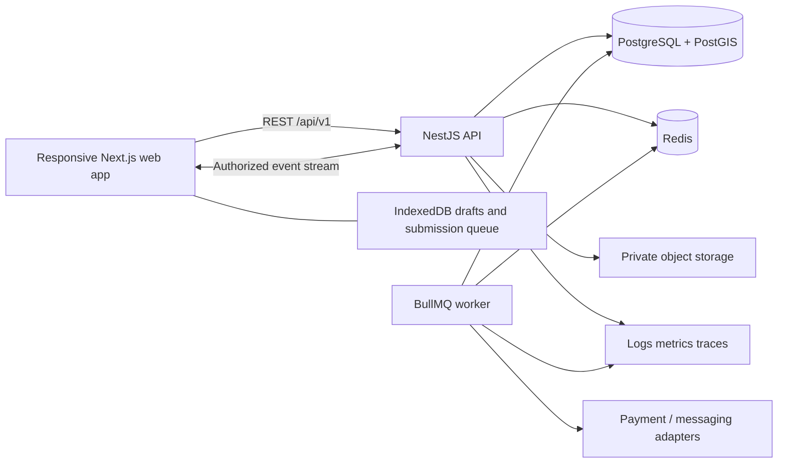
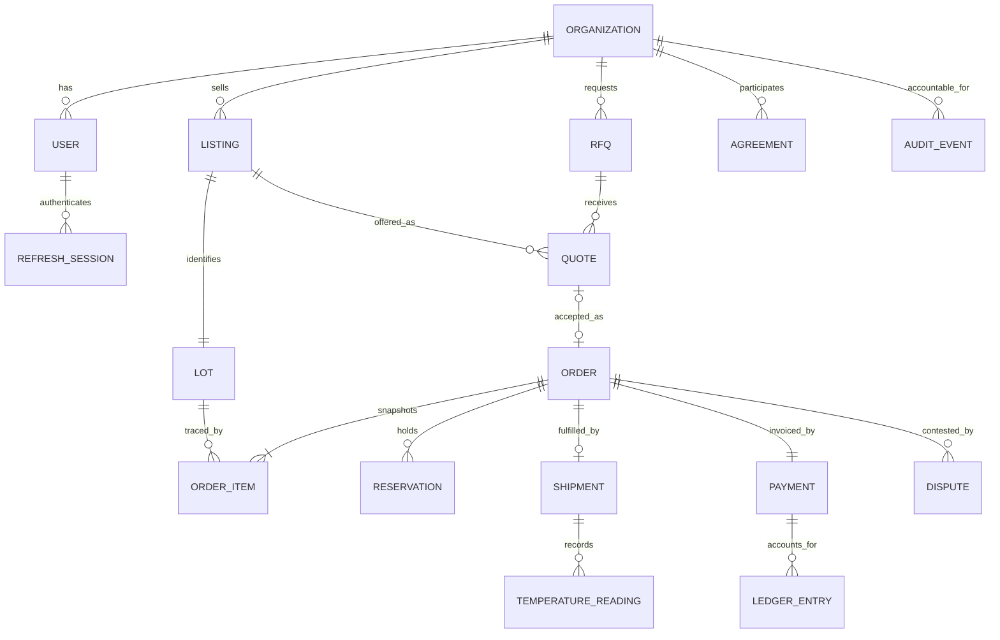
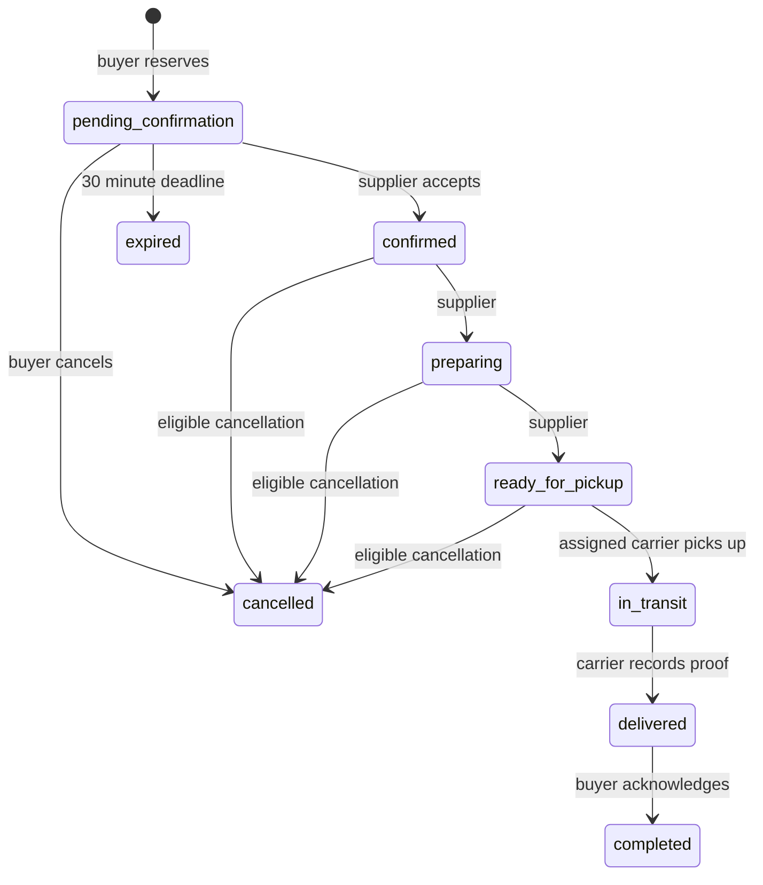

# HarvestLink architecture — contract version 1.0.3

Approved for MVP implementation by the Principal Agent on 5 November 2026. This document describes intended and required behavior; implementation completion is reported separately with test evidence.

HarvestLink connects agricultural and seafood suppliers to organizational buyers, with assigned logistics partners and platform administrators. The MVP is a complete transaction demonstrator using persistent SQL and simulated payments. Currency is PHP for the demo; the production launch jurisdiction, currency, provider eligibility and hosting budget remain deployment decisions.

## System and bounded contexts

| Context | Owns | Relationships |
| --- | --- | --- |
| Identity and verification | Users, organizations, refresh sessions, evidence, approval | Supplies actor and organization eligibility to every command |
| Catalog and traceability | Listings, source lots, stock, source metadata | Supplies immutable lot/price snapshots to orders |
| Procurement | RFQs, quotes, orders, reservations, agreements | Reserves catalog stock; requests fulfillment and invoice |
| Fulfillment | Carrier assignment, custody/status, temperature readings | Updates order delivery state; flags safety exceptions |
| Payments and disputes | Invoices, simulated custody, balanced ledger, resolutions | Uses server order total; gates pickup/release |
| Operations and insight | Audit log, outbox, dashboards, freshness jobs | Consumes domain events; never changes balances from analytics |

One modular backend and a separate worker keep transactions local. Only the database is authoritative. Redis queues, socket messages, browser state and cached totals cannot determine stock or payment effects. A transaction inserts its audit and outbox rows before commit; a worker publishes events at least once.

Deployment uses Docker on AWS with managed PostgreSQL, Redis, private object storage and encrypted volumes. Local development supports file-backed PGlite because Docker and psql are unavailable in the initial workspace. It uses the portable core SQL, not an in-memory JavaScript mock. Production PostgreSQL additionally applies the mandatory PostGIS migration. PGlite does not validate production spatial behavior; production database integration remains a separate check.

## Data relationships

One MVP listing identifies one physical lot. Product description and lot facts remain distinct in the model/API. Once created, source lot fields are immutable. New harvests create new lots; changing a title or price never changes an order snapshot. Split/merge lineage and multi-lot allocations are V1 additions with migration and event version review.

## Wire contracts

The authoritative package is [OpenAPI](../contracts/openapi.yaml), [TypeScript DTOs](../contracts/domain.ts), and [event JSON Schema](../contracts/events.schema.json). The OpenAPI file uses JSON syntax, which is valid YAML; regenerate with `python contracts/generate_openapi.py`. API base: `/api/v1`. UUID IDs, UTC ISO-8601 timestamps, camelCase fields. All responses are `{data: value}`, paginated lists `{data: [], meta: {page,pageSize,total}}`, errors `{error: {code,message,requestId,details?}}`. Lists default to 20 and cap at 100. Unknown request fields are rejected.

Money is an integer number of PHP minor units. Quantities are decimal strings, at most three fractional places, maximum `1000000.000`; positive inputs except explicit inventory deltas. Price per unit is `1..10000000` minor units; total is at most `100000000000000`. Calculate using decimal arithmetic or integer thousandths, round each line half-up once to a minor unit, then sum. Do not use binary floating-point multiplication for settlement. Units never convert implicitly; kg analytics exclude crates.

| Area | Exact operations (under `/api/v1`) |
| --- | --- |
| Identity | `POST /auth/register`, `/auth/login`, `/auth/refresh`, `/auth/logout`; `GET /auth/me` |
| Organizations | `GET /organizations` (admin), `/organizations/partners`, `/organizations/me`; `PATCH /organizations/me`; `POST /organizations/{id}/verification` |
| Listings | `GET/POST /listings`; `GET/PATCH /listings/{id}` |
| RFQs | `GET/POST /rfqs`; `POST /rfqs/{id}/quotes`; `POST /quotes/{id}/accept` |
| Orders | `GET/POST /orders`; `GET /orders/{id}`; `POST /orders/{id}/status` |
| Logistics | `GET/POST /shipments`; `GET /shipments/{id}`; `POST /shipments/{id}/status`; `GET/POST /shipments/{id}/temperatures` |
| Payment/disputes | `GET/POST /orders/{id}/payment`; `GET/POST /disputes`; `POST /disputes/{id}/resolution` |
| Other | `GET/POST /agreements`; `GET /analytics`, `/audit` (admin), `/health` |

Quote acceptance has no body: the buyer, destination, delivery deadline and notes come from the RFQ; price and lot come from the accepted quote. The transaction rechecks eligibility and stock. One full award per RFQ in MVP; competing quotes become rejected. One supplier per order; mixed-supplier carts must be split explicitly by the buyer UI. Order money is server-calculated; delivery fee is zero in the MVP sandbox and clearly shown. No silent carrier fee promise.

### State and authorization rules

- Reservation: atomic `available -= quantity`, `reserved += quantity`; cancel/expire reverses; pickup consumes reserved once. Both quantities remain nonnegative. Lock affected listings in stable ID order. Confirming removes reservation expiry; expiry worker and supplier confirmation race under the same transaction lock.
- Supplier confirms only own unexpired pending order, then prepares and marks ready. Buyer may cancel own order before pickup; admin may cancel before pickup with a reason. No ordinary cancellation after pickup. Terminal states cannot transition. Held sandbox funds refund in the same transaction as eligible cancellation.
- Shipment: `scheduled -> picked_up -> in_transit -> delivered`; pickup requires ready order and held payment. `picked_up` already makes order `in_transit` and consumes reservation. Delivery requires proof. Exceptions require reviewed recovery with an audit reason; never silently clear excursion history.
- Payment: `unpaid -> held` by buyer after order confirmation; `held -> released` by buyer after delivery; `held -> refunded` by admin or eligible cancellation; `held -> disputed` by participant complaint. Only admin resolution moves disputed funds to released/refunded. Exact order total only. The ledger is balanced per action and payment rows locked; repeat keys and webhook IDs never duplicate effects. MVP is a simulation, not real custody/escrow.
- Verification: public registration cannot assign admin. Supplier/logistics registration starts pending. Only admin changes verification, with reason and no self-approval. Material licensing changes reset supplier verification. Paused/suspended suppliers cannot receive new orders.
- Listings: draft/paused can become active only when verified and eligible. Expired, recalled, unknown-chain and excursion lots cannot be purchased. Produce may use ambient; seafood must be chilled/frozen with storage bounds. Harvest/catch cannot be future; expiry must follow harvest and exceed delivery deadline. Produce uses `catchMethod: not_applicable`. Manual claims remain `supplier_declared`.
- Agreement MVP creates draft supply intentions only. No implicit supplier acceptance, legal signature, inventory promise or automatic order generation.

| Capability | Supplier | Buyer | Logistics | Admin |
| --- | --- | --- | --- | --- |
| Private organization profile | Own | Own | Own | All |
| Public partner cards/listings | Read | Read | Read | Read |
| Listing mutations | Own | No | No | Pause/recall with reason |
| RFQs/quotes | Open RFQs + own quotes | Own RFQs + all received quotes | No | All |
| Orders | Own supplied | Own purchased | No; use assigned shipments | All |
| Shipment/temperature | Read own | Read own | Assigned update | Reviewed operational control |
| Financial actions | Open dispute | Hold/release own; dispute | No | Refund/resolve with reason |
| Verification and audit | No | No | No | Yes |

Public organization cards contain only ID, name, role, verification status and coarse location. Listing location and lot origin are rounded to one decimal degree; precise origin is stored privately. Pickup and delivery coordinates are available only to transaction participants. Private certificates/licenses are owner/admin-only. RFQ suppliers never see competitors' quotes. Inaccessible IDs return 404. Role alone never grants another organization's records.

### Offline, auth and events

Preserve draft data in IndexedDB and queue order submissions with an unchanging idempotency key. Display pending submission until the server confirms. Never show stock as guaranteed offline. Retry timeouts and transient failures with bounded exponential backoff; 400/403/409/422 require user correction. After 24 hours, require a fresh review and new intent. Store successful responses for idempotency at least seven days, scoped by organization and operation with a canonical request fingerprint; same key/different request is 409. Check existing idempotency records before fresh-stock validation. Only one session refresh runs at a time. Logout purges organization-specific cached data/queues; never replay another user's order.

Access JWT lasts 15 minutes; browser keeps it in memory. Refresh token is opaque, hashed server-side, rotated on use and stored in an HttpOnly, Secure, SameSite cookie scoped to `/api/v1/auth`; local HTTP has an explicit development exception. Refresh lifetime is 14 days. Reuse revokes the entire token family. Logout revokes the family and clears cookie. Validate exact configured Origin for cookie-authenticated mutations; no wildcard credentials. Validate signing algorithm, issuer/audience and session state. Rate-limit auth; use a modern password hash. Demo credentials are environment-configured and demo seeding disabled in production.

Socket.IO namespace `/events`, path `/socket.io`, handshake `auth: {accessToken}`. Server derives organization room and authorizes it; clients cannot choose arbitrary rooms. Emit `domain.event` with the event schema. Revalidate expiry; reconnect refreshes token and refetches visible lists/details using REST, which is authoritative. Clients deduplicate event IDs and ignore stale aggregate versions. Event payloads omit documents, secrets and unnecessary financial detail. Payment/dispute events exclude logistics audiences. Background notifications use adapters and explicit sandbox indicators until a live provider is configured.

### Error examples and invariants

An insufficient-stock response is HTTP 409 with `error.code = INSUFFICIENT_STOCK`, field details and a request ID. Other stable codes include `VALIDATION_ERROR`, `UNAUTHENTICATED`, `FORBIDDEN`, `NOT_FOUND`, `VERSION_CONFLICT`, `IDEMPOTENCY_CONFLICT`, `INVALID_TRANSITION`, `LOT_EXPIRED`, `COLD_CHAIN_UNSAFE`, `VERIFICATION_REQUIRED`, and `RATE_LIMITED`.

Required tests: no negative stock under concurrent ordering; duplicate request has one order and one financial effect; changed-body duplicate key is rejected; frozen quotes/lot snapshots survive listing edits; expiry races do not double-release; unauthorized tenant IDs expose nothing; manual readings cannot claim sensor verification; delivered goods link to source lot; no fund release while disputed; buyer retry after server commit returns the original order.

## Release boundaries and evidence

MVP: four role flows, manual verification, traceable listings, RFQ full award, bulk ordering, durable retry, carrier assignment, manual temperatures, sandbox invoice/payment/dispute, draft agreements, scoped analytics and audit. V1: real payment provider/country review, signed temperature ingestion, private document upload pipeline, contracts/acceptance, partial fulfillment, recurring generation, split/merge traceability, food-safety recall workflow, SMS/WhatsApp, restore drill and commercial security hardening. V2: validated forecasting and matching, transport optimization, broad localization, measured scaling.

Forecasts are labeled insufficient data until at least four complete weeks; baseline trailing averages are identified as estimates. Seeded demonstrations are not evidence of predictive performance. No automated decision should claim a safety certification or guarantee freshness.

References for technology capability (version pinning/install evidence belongs in the lockfile and build report): [NestJS OpenAPI](https://docs.nestjs.com/openapi/introduction), [NestJS gateways](https://docs.nestjs.com/websockets/gateways), [PostGIS](https://postgis.net/docs/), [BullMQ](https://docs.bullmq.io/), [PGlite](https://pglite.dev/). These links identify upstream documentation; actual verification is performed during implementation.
