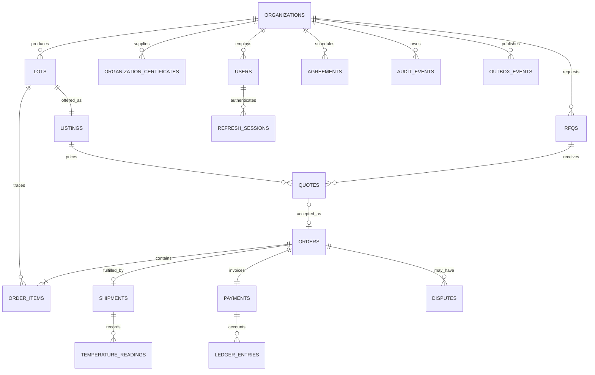

# Database implementation and operations

The production database is PostgreSQL with PostGIS. `apps/api/src/database.ts` exposes parameterized `query`, `exec`, `transaction`, and `close` through `openDatabase`. Native transactions check out one pool client until commit or rollback. Local demos use file-persistent PGlite; tests use isolated `memory://` databases. `DATABASE_URL` selects PostgreSQL; `DB_DIR` (or `PGLITE_DATA_DIR`) selects the local directory. Production startup refuses PGlite and checks `PostGIS_Version()`.

## Migrations and seeds

`001_core.sql` creates relational organizations, users, verification certificates, lots, listings, RFQs, quotes, orders and immutable order lines, shipments, temperature records, payments, balanced ledger entries, disputes, agreements, refresh sessions, idempotency keys, audit records, transactional outbox, and notification deliveries. `002_postgis.sql` installs PostGIS and generated geographic points with GiST indexes. PGlite skips only the native spatial migration; it executes the same core PostgreSQL SQL.

Migrations run in one transaction with a PostgreSQL advisory lock, filename/checksum ledger, and checksum mismatch rejection. Never edit an applied migration; add a new migration. `MIGRATIONS_DIR` can override the default `db/migrations` path beneath the working directory. Production uses a separate migration principal before application rollout, then `openDatabase({migrate:false})` with the runtime principal. The supplied `db/runtime-role.sql` grants an externally provisioned runtime login a restricted NOLOGIN group; it contains no passwords.

From the repository root, run `node --env-file-if-exists=.env.local --import tsx db/run.ts` to migrate. Add `--seed` only in demo environments, with `DEMO_MODE=true` and an explicit `DEMO_PASSWORD` generated by setup. Seeding is one transaction, refuses `NODE_ENV=production`, and never replaces existing demo data. `seedDatabase(db,{passwordHash,now?})` accepts a precomputed scrypt hash and optional fixed fixture date. Demo identities are `supplier`, `fisher`, `buyer`, `logistics`, and `admin` at `harvestlink.demo`.

Seed fixtures include six listings from a farm cooperative and fishing collective, four orders, a current refrigerated shipment with six manual temperature readings, a quote, a draft recurring agreement, a pending supplier verification, and balanced sandbox payment entries. Dates are relative to seeding. A persisted demo becomes old naturally; create a fresh separate demo database when fresh dates are needed, preserving the existing database for review.

## Relationships

Organizational ownership and permissions are checked in the API, including buyer/supplier/logistics relationships on orders. This initial schema does not claim PostgreSQL row-level security. Runtime credentials must not own tables, bypass row-level security, disable triggers, or inherit the migration owner role. Enabling RLS later requires transaction-local tenant context and explicit cross-party policies and tests.

## Integrity and concurrency

- `available_quantity` means unreserved sellable stock. Reservation atomically subtracts available quantity and adds reserved quantity under a sufficient-stock predicate. Cancellation reverses the reservation; pickup consumes reserved quantity. `NUMERIC(12,3)` preserves decimals and checks enforce nonnegative stock and the API ceiling of 1,000,000 units.
- A single transaction must cover the inventory mutation, order, immutable lines, audit event, outbox event, and idempotency result. Lock multiple listing rows in UUID order to avoid deadlocks. Native PostgreSQL `READ COMMITTED` with `SELECT FOR UPDATE` or guarded `UPDATE ... WHERE available_quantity >= requested` prevents stale stock reads; a zero-row update means stock is unavailable. Retry serialization/deadlock failures only with the same idempotency key.
- Monetary values are integer centavos stored as bounded `BIGINT`; convert to safe JavaScript numbers in DTO mappers. The maximum total is 100,000,000,000,000 minor units. Order line checks enforce PostgreSQL numeric `round(quantity * price)`; positive values use half-up rounding. There is no binary floating-point stock or price arithmetic.
- A quote can produce at most one order, an RFQ at most one accepted quote, an order at most one MVP shipment/payment, and an order at most one active dispute. Compound order-line foreign keys prevent a mismatched listing and lot.
- `order_items.lot_snapshot` stores the immutable lot origin and freshness snapshot accepted with the commercial terms. `delivery_location` and shipment locations are immutable nested snapshots. Organizations, catalog rows, status, quantities, sessions, and other operational records remain relational.
- The idempotency primary key is `(organization_id, scope, key)` with a stored request fingerprint, status, and response. The API must reject reused keys with different payloads, and transactionally persist successful replies. Retain keys at least seven days and reconcile pending client submissions before resending after that horizon.
- Append-only triggers block updates/deletes on audit records, ledger entries, and order snapshots. Deferred ledger constraints require every transaction ID to sum to zero at commit; one-sided financial writes roll back. Transactions also contain the corresponding payment/order state transition. The database owner can bypass these protections, so role separation and externally retained audit backups remain necessary.
- The outbox is committed with business state; workers publish and mark delivery separately. Delivery can repeat, so consumers deduplicate by event ID. Notifications have an event/channel/recipient unique key.

## Indexes and geospatial queries

Indexes cover supplier/buyer order history, active marketplace category/date, full-text catalog search, RFQ deadlines, reservation expiry, lot expiry, shipment assignments, temperature history, pending verifications, refresh expiry/families, idempotency expiry, audit lookup, and unpublished outbox records. Validate production plans with `EXPLAIN (ANALYZE, BUFFERS)` on representative data; unused indexes should be removed via reviewed migrations.

PostGIS stores geography points generated from validated latitude/longitude. For example, use `ST_DWithin(location_geog, ST_SetSRID(ST_MakePoint($1,$2),4326)::geography, $3)` for a radius in meters, where parameters are longitude, latitude, and radius. Exact farm/vessel coordinates are private. The public DTO must return the approved coarse coordinates; authorized fulfillment uses exact snapshots.

## Retention and recovery

These are implementation defaults for review before commercial launch, not assertions of a country's statutory requirements. A legal hold overrides deletion. No automated financial or traceability deletion runs in the MVP.

| Record | Proposed default | Mechanism and safeguard |
|---|---|---|
| Refresh sessions | Expired/revoked sessions plus 30 days | Batched expiry cleanup; preserve family-reuse investigation window. |
| Idempotency responses | At least 7 days | Batched `expires_at` cleanup; no unbounded client retries beyond retention. |
| Delivered outbox / notification attempts | 90 days | Archive then delete only delivered events after downstream confirmation. |
| Raw temperature readings | 24 months | Archive with shipment/lot references; retain excursion summaries and legal holds. |
| Commercial, payment, ledger, lot lineage and audit records | 7 years provisionally | Archive under separate retention credentials; policy approved for launch country and contracts first. |
| Rejected verification uploads | 90 days after final appeal, provisionally | Object-storage lifecycle only after record/legal-hold review. |
| Database backups | Daily backup retention 35 days plus approved monthly archives | Encrypt, restrict restoration roles, run restore drills. |

Append-only tables require a deliberately privileged, audited archival process; the application role cannot delete them. Store archive integrity manifests outside the primary database before any approved purge. Pseudonymize optional contact details after legitimate retention expires while preserving legally required trade records. Never log passwords, token values, banking credentials, or private document URLs.

For native PostgreSQL use provider-managed point-in-time recovery and encrypted backups; target recovery objectives remain proposals until a timed restoration test passes. For local PGlite, close the application before copying its database directory; a live file copy is not a verified backup. Do not run multiple API processes against the same PGlite directory.

## Verification evidence and limits

`db/database.test.ts` checks repeatable migrations/seeds, stock constraints, competing reservation transactions, rollback, append-only records, balanced-ledger enforcement, durable idempotency uniqueness, lot/geographic validation, source-lot snapshots, production fallback rejection, and file persistence across restarts. All eleven passed locally on PGlite. This verifies PostgreSQL core behavior in the embedded engine, not independent native PostgreSQL clients or PostGIS execution. Native PostGIS and multi-process concurrency remain deployment/CI checks.

Primary implementation references: [PGlite API](https://pglite.dev/docs/api), [PGlite persistence](https://pglite.dev/docs/about), [node-postgres transactions](https://node-postgres.com/features/transactions), [parameterized queries](https://node-postgres.com/features/queries), and [PostgreSQL concurrency control](https://www.postgresql.org/docs/current/mvcc.html).
