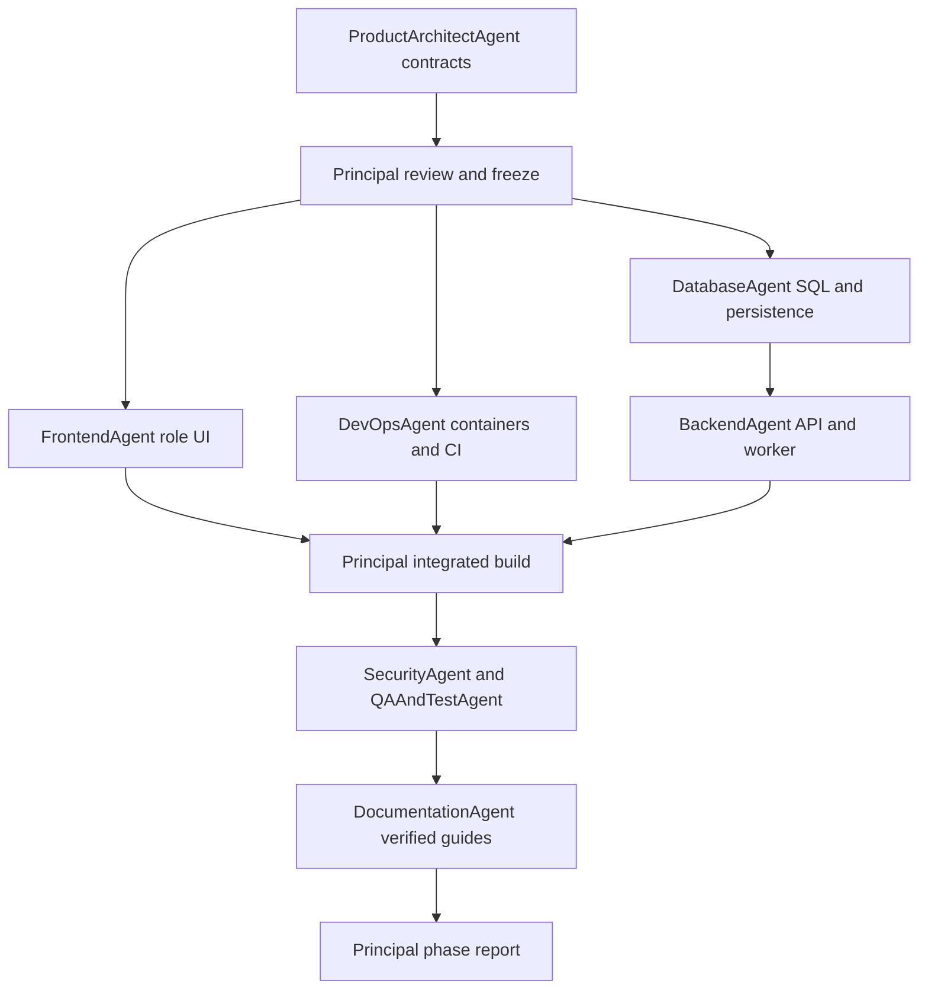

# Delivery plan and phase gates

The user approved the plan and delegated further approvals to the Principal Agent on 5 November 2026. No further routine approval is needed for authorized implementation/review. External provisioning still depends on actual account credentials and configuration; reports must distinguish prepared deployment files from deployed resources.

## Sequence and responsibilities

All briefs specify objective, input, output, acceptance and sequence. Maximum three subagents run alongside the Principal; waiting roles are scheduled as slots free. Agents own separate paths and escalate contract conflicts to the Principal.

| Agent | Input and output | Acceptance/sequence |
| --- | --- | --- |
| ProductArchitectAgent | Mission/approved stack -> architecture, decisions, DTOs, OpenAPI, event schema | Exact schemas, routes, invariants, state rules; first before builders |
| DatabaseAgent | Frozen model -> migrations, seeds, persistence, indexes, retention notes | Install/upgrade and constraints; authoritative SQL; before API integration |
| BackendAgent | Frozen API + SQL -> API/worker, auth, workflows, adapters, tests | RBAC/tenant checks; stock/payment atomicity; >=80% core line/branch coverage target with actual report |
| FrontendAgent | Frozen DTOs/flows -> responsive role UI, offline queue, localization structure | Real API integration, visible reconnect/conflict behavior, keyboard/accessibility checks |
| DevOpsAgent | Runtime topology -> Docker, CI, IaC, logs/metrics, backup procedure | Reproducible commands, no embedded secrets, clear prepared/executed distinction |
| SecurityAgent | Architecture + implementation -> threat model and findings/checklist | Negative auth tests, token handling, financial transitions, PII exposure; no unreported findings |
| QAAndTestAgent | Personas + actual app -> E2E/UAT/load scripts and report | Per-role happy/failure flows, cross-tenant denial, duplicate request, offline retry; report measured outcomes |
| DocumentationAgent | Reviewed system/test evidence -> developer, admin and supplier guides | Exact working commands and screens, plain-language field use, explicit limitations |

## MVP

Deliver a coherent local full-stack application with persistent demo data, four role flows, traceable lots, verified supplier eligibility, quote-to-order and direct bulk ordering, stock reservations, pickup and delivery, temperature hooks, sandbox funds/disputes, analytics, audit and documented operations. Draft agreement records are included; actual recurring legal/financial execution is V1. The Principal integrates and reviews every deliverable.

Exit: runnable artifact; schema and contract checks; backend core coverage reported; role UI walkthroughs; retry/idempotency and tenant tests; security report; relevant build/test evidence; honest blockers. A successful local demo is not a production release.

## V1

Commercial readiness: launch jurisdiction/provider selection, real fund flow/reconciliation, private document ingestion and scanning, full contracts and milestone payments, recurring agreement acceptance/generation, partial fulfillment, split/merge traceability, recall response, signed sensor integration, SMS/WhatsApp, restoration drill, production PostGIS/concurrency checks, accessibility review and load targets agreed for hosting capacity.

Exit: verified provider support and credentials, runnable live adapters in test mode, managed backup restoration evidence, security findings resolved, UAT acceptance and deployment/rollback runbooks. Missing external accounts or commercial decisions remain explicit blockers rather than simulated completion.

## V2

Forecasting, pricing trends and demand matching improve on measured baselines; route optimization and scaling follow observed bottlenecks. Localizations are validated with actual users. Forecast quality is gated on sufficient historical data; synthetic seed data does not satisfy that gate.

## Risk register

| Risk | Mitigation | Owner/evidence |
| --- | --- | --- |
| Offline duplicate orders | Durable intent queue, idempotency fingerprints, original response replay | Backend/Frontend: reconnect-after-commit test |
| Overselling or unit errors | Transaction locks, decimal quantities, explicit units | Database/Backend: concurrent reservation and rounding tests |
| Spoilage/broken traceability | Eligibility checks, immutable lot snapshot, custody and excursion records | Database/QA: delivered lot trace and recall scenario |
| Unsupported escrow/payment loss | Sandbox boundary, provider gate, balanced ledger, reconciliation | Backend/Security: duplicate financial-action tests |
| Cross-tenant leakage | Actor/participant query scope, private DTOs, coarse public locations | Security: foreign-ID negative tests |
| Fraud or false freshness | Verification evidence, expiry, declared-vs-measured provenance | Admin/QA: suspension and expired-license scenarios |
| Data loss/operational outage | Persistent SQL, backup/restore, worker/outbox retries, health checks | DevOps: restoration and failure-recovery evidence |
| Scope/analytics overclaim | Frozen MVP, versioned changes, baseline/data sufficiency gates | Principal: phase report and documented limitations |

## Status-report format

Every report lists completed items with artifact/test references, work in progress, blockers, risks, decisions and the next gate. It records executed tests separately from provided scripts, local persistence separately from production infrastructure, and simulated integrations separately from live connections. Final integration notes reference all nine requested deliverable categories.
