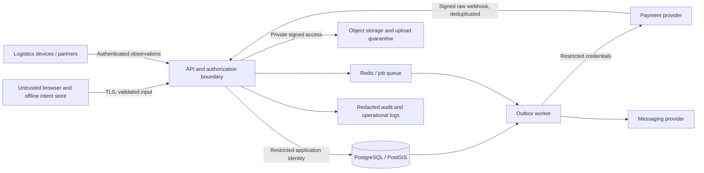

# Security threat model

Status: design requirements plus targeted implementation review. Date: 2026-11-05 (Asia/Manila). Observed evidence and open findings are in [security-report.md](security-report.md); requirements below are not blanket claims of implementation.

Owner: SecurityAgent. Approver: Principal Agent. Scope: B2B farmer/fisherman marketplace, browser, API, worker, PostgreSQL/PostGIS, Redis, object storage, and external payment/messaging adapters. This document defines engineering release conditions, not legal certification.

## Security boundaries and assets

Primary assets are organization membership, identities and sessions, private verification documents, precise farm/fishing locations, lot lineage and custody records, inventory reservations, order terms, financial ledger records, and deployment secrets. Browser storage, uploaded bytes, provider callbacks, device readings, and client-supplied organization IDs are untrusted.

Public marketplace data must be an explicit projection. Exact coordinates, contact details, internal verification evidence, negotiated prices, payment references, and private orders must not leak through search responses, errors, exports, events, logs, or cached pages. Location precision disclosed to buyers is a product policy, not an accidental consequence of a database geometry field.

## Required design decisions

### Identity, sessions, and resource access

- Issue short-lived access JWTs (proposed maximum 15 minutes). Validate the configured algorithm, signature, issuer, audience, expiry, and session state. Reject algorithm substitution and untrusted key URLs. Signing secrets/keys come from runtime secret management.
- Keep browser access tokens in memory. Use a cryptographically random refresh token in a host-only `HttpOnly`, `Secure`, `SameSite=Lax` cookie; use a separate explicit local development configuration for HTTP. Never put access or refresh tokens in localStorage, IndexedDB, URLs, logs, or service-worker caches.
- Persist only refresh token digests with session/family IDs, expiry, rotation and revocation state. Rotate atomically and revoke the entire family if a spent token is reused. A client must serialize refresh operations; ambiguous refresh failure requires login instead of weakening replay detection.
- Passwords require a password-specific adaptive hash and configured work factor. Random refresh tokens may use SHA-256 digests because they have high entropy; this does not make SHA-256 suitable for passwords. Password reset and membership removal revoke relevant sessions.
- Cookie-authenticated refresh/logout endpoints require exact trusted Origin validation and CSRF protection; login also checks Origin to prevent login CSRF. Reject missing/untrusted browser Origin for these routes. Never accept cookies as an alternate authentication path on an otherwise bearer-authenticated business endpoint without adding CSRF protection.
- A request receives an effective organization only after the server verifies an active membership. Roles alone are insufficient: an order is readable only by its buyer, supplier, assigned logistics party with a limited projection, or an authorized administrator. Assignment, consent, and verification status are checked for the operation.
- Every detail/list/export/mutation/event/file endpoint enforces resource policy. Background jobs re-check the relevant authoritative state; IDs supplied by a queued job are not authority. High-impact actions re-check current membership/session state, not only a stale JWT role.
- Database row policies, where used, are defense in depth. Connection-pool tenant context must be transaction-local and cleared automatically. The runtime database identity must not own protected tables or bypass row security. Integration tests must use that runtime identity, not only a superuser.
- Administrative review, suspension, refund/release, and impersonation (if introduced) require explicit capabilities, reason fields, and audit records. No hidden universal organization override.

### Offline intents, idempotency, and concurrency

- Offline storage contains minimal drafts and submission intents, not credentials, payment data, verification documents, or complete private response caches. Partition intents by user ID and organization ID. The service worker caches the static shell only; authenticated API responses are excluded.
- On logout/account switch, clear or seal inaccessible pending work and explicitly tell users about unsent drafts. Never submit a previous user's queue after a new login. IndexedDB provides persistence, not protection against another device user or XSS; shared-device mode clears drafts on logout.
- An intent remains `pending submission` until the server confirms acceptance. Reconnection re-authenticates and revalidates price, stock, freshness, role, and membership. Conflicts require a visible resolution, never a silent changed order.
- Scope idempotency to authenticated organization, principal, operation, and key. Persist a normalized request fingerprint and result reference atomically with the business mutation. Same key and same fingerprint returns the original result; different payload returns `409`. Authorization is re-checked before returning the stored result.
- Retryable intents have stable client intent IDs with a durable unique constraint, including after a short-lived response cache expires. Publish the retry horizon. An expired or unknown outcome must be reconciled by intent ID before creating a new order.
- Reserve stock using one PostgreSQL transaction with row locks or conditional updates plus constraints. Concurrent order attempts cannot cause negative stock. Transactions include the order/reservation, idempotency record, audit record, and outbox event. Decimal quantities and currency amounts have explicit precision; client totals are not trusted.

### Financial and provider boundaries

- MVP simulated payment state must be visibly labeled sandbox/demo and must never claim funds were held, transferred, or escrowed. A provider adapter and an internal ledger are distinct from actual payment custody. No card PAN/CVV or raw bank credentials are stored.
- Production starts only with explicitly supported production adapters and persistent infrastructure. Startup rejects demo identity, in-memory transactional storage, seeded public credentials, placeholder signing keys, insecure cookies, and simulated payment mode. No environment flag may silently reinterpret demo transactions as live funds.
- Validate payment signatures over the exact raw body before parsing business events. Verify the provider-specific timestamp/replay policy, endpoint/account binding, and allowlisted event schema. Invalid signatures never mutate state.
- Persist a unique provider/account/event ID. Duplicate valid events produce no repeated financial effect and can return success after the original commit. Out-of-order events cannot move a final state backward. Order amount, currency, organization, and provider object must match server records.
- Update ledger entries, settlement state, processed-event record, audit, and outbox atomically. A balance or order status is not proof of payment; reconciliation compares durable provider records and ledger entries. Refund and release requests use provider idempotency identifiers and explicit authorized transitions.
- Financial data, databases, backups, and private objects require encryption at rest with environment-separated keys; TLS protects transport. Restricted fields need envelope encryption where the data policy requires it. Key rotation and restore access are documented. The application never prints secrets or full financial payloads in logs.

### Uploads, input, and browser behavior

- Validate shape, type, length, enum, precision, and range on all API and event inputs. Reject unknown security-sensitive fields and client-assigned roles, approval states, totals, or ownership. SQL uses parameters; sorting/filtering uses allowlists.
- Upload allowlists define file formats, per-file and per-organization byte limits, counts, dimensions, and decompression limits. Server-generated object names and MIME/signature checks prevent path traversal and disguised executables. Reject SVG/HTML unless a dedicated sanitization pipeline is implemented.
- Uploaded verification documents remain private and quarantined until scanning completes. A scan failure denies access. Signed URLs are short-lived and issued only after resource authorization. Private documents are served as attachments; product images use a separate controlled public derivative path with metadata stripped.
- Deny arbitrary server-side fetch URLs. If import-by-URL is introduced, enforce network/host allowlists, redirect validation, response limits, and private-address blocking to prevent SSRF.
- Escape rendered content, avoid unsafe HTML, and use a tested Content Security Policy, frame restrictions, MIME-sniffing protection, strict CORS origins, and secure transport. Do not enable wildcard credentialed CORS.
- Bound request bodies, pagination, query complexity, websocket subscriptions, upload bytes, and job retries. Apply distributed login/refresh/webhook/mutation rate limits and predictable timeout/backoff behavior. Never use user-controlled fields directly as metric labels.

### Audit, food provenance, and operations

- Record actor, effective organization, action, resource, timestamp, correlation ID, reason, and relevant changes for security/commercial events. Do not include tokens, passwords, full identity documents, or complete webhook bodies. Separate append-only audit permissions from normal application mutations.
- Traceability changes are appended/corrected with reason and source; delivered lots cannot be silently rewritten. Recall and verification holds block new commercial transitions. Temperature readings preserve observed time, received time, source, units, and trust status; absence of telemetry is not evidence of safe storage.
- Persist critical events in a transactional outbox before dispatch. Workers tolerate retries and poison messages. Redis loss does not lose authoritative orders or financial state.
- Protect CI identities, pin dependencies with a lockfile, scan secrets and dependencies, restrict deployment permissions, and avoid secrets in build artifacts. Backups are encrypted and restoration is tested. Retention/deletion policies remain pending launch-country and operational decisions; audit retention is not indefinite by default.

## Threat register and required demonstrations

| ID | Abuse case / impact | Required demonstration | Release severity if unresolved |
|---|---|---|---|
| T01 | Guess another organization's order/document ID; expose commercial or identity data | Two organizations with same role cannot list/get/mutate/download/subscribe to each other's private resources | High |
| T02 | Steal/replay refresh token or retain access after suspension | Spent refresh token revokes family; expired/wrong-audience JWT rejected; suspended membership cannot transact | High |
| T03 | Reconnect/replay order submission after commit; duplicate order or oversell | Disconnect-after-commit and concurrent stock tests yield one order per intent and nonnegative stock | High |
| T04 | Forge/replay/out-of-order payment webhook; duplicate release | Invalid signature and mismatched amount rejected; duplicate valid event has one ledger effect | Critical for live funds |
| T05 | Stored XSS or malicious upload; compromise sessions/documents | Escaping/CSP verified; disguised/oversized/path-traversal uploads denied; unauthorized URL issue denied | High |
| T06 | Tamper origin, custody, or temperature evidence; misleading safety claims | Original audit remains; correction has actor/reason; untrusted readings and missing data are explicit | High |
| T07 | Shared-device queue submits under wrong buyer | Account switch cannot submit/read previous account intents; offline requests cannot bypass server validation | High |
| T08 | Demo configuration or secret reaches production | Production startup rejection tests; repository/artifact secret scan; key and cookie configuration checks | Critical |
| T09 | Queue, search, or upload abuse exhausts service | Bounded inputs, rate-limit tests, retry cap, load report, and recovery runbook | High |
| T10 | Backup/log export leaks identity or financial data | Redaction tests, restricted export/backup roles, encrypted storage config, and restoration evidence | High |

## Review status and residual risk

The Principal froze the MVP contracts and authorized implementation; see [integration log](integration-log.md). A subsequent independent source review and executed 29-test local suite cover authentication, resource authorization, idempotency, inventory, simulated ledger, and traceability. The independent production-entrypoint check confirms startup fails closed. The expected-price amendment and browser findings still require final evidence in [security-checklist.md](security-checklist.md).

The delivered local architecture uses persistent PGlite or native PostgreSQL and an in-process maintenance/outbox loop. Redis/BullMQ, upload storage/scanning, provider webhooks, hosted encryption and recovery are prepared or absent capabilities, not proven running controls. Browser cache contains only a public offline page and icon; private order intents use IndexedDB. Precise source coordinates require transaction-participant access under ADR-006. No live-fund or regulatory-custody claims are authorized.

Principal design signoff: APPROVED for MVP implementation. Principal local-demo release signoff: PENDING final remediation evidence. Commercial release: NOT APPROVED. Accepted exceptions must include owner, impact, compensating controls, expiry, and linked evidence. A synthetic local demo does not justify handling live funds with unresolved high/critical findings.

## Design references

Reviewed 2026-11-05. These are source guidance, not implementation evidence.

- [OWASP Authorization Cheat Sheet](https://cheatsheetseries.owasp.org/cheatsheets/Authorization_Cheat_Sheet.html): deny-by-default and per-request authorization guide the resource-access requirements.
- [OWASP REST Security Cheat Sheet](https://cheatsheetseries.owasp.org/cheatsheets/REST_Security_Cheat_Sheet.html): transport, token validation, and input handling inform the API boundary.
- [OWASP File Upload Cheat Sheet](https://cheatsheetseries.owasp.org/cheatsheets/File_Upload_Cheat_Sheet.html): layered validation, access controls, and storage separation inform upload requirements.
- [IETF RFC 9700, section 4.14](https://www.rfc-editor.org/rfc/rfc9700.html#section-4.14): refresh replay detection informs session rotation/revocation. This application is not thereby claimed to be an OAuth authorization server.
