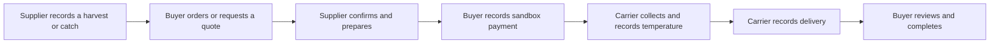

# Using HarvestLink

Choose the account for your organization. Your role determines which actions you can perform; changing screens cannot grant another role's permissions.

## Farmers and fishers

1. Complete My organization with contact, location, license, and certificate references. An administrator reviews verification. Changing licensing information can return your profile to review.
2. Open My inventory and Add listing. Enter quantity, unit, minimum order, price, and a unique batch/lot code.
3. Record when the goods were harvested or caught, their expiry, source, and storage conditions. Seafood needs chilled/frozen handling and catch information. These are supplier declarations, not a safety certification.
4. Publish only stock you can supply. Existing reservations cannot be removed by an inventory correction. Give a reason for corrections.
5. In Orders, confirm the buyer's request, start preparation, mark it ready, and schedule collection with a logistics partner.

Orders awaiting confirmation reserve stock for 30 minutes. Confirmed orders keep their reservation until collection or eligible cancellation. A recalled or expired lot cannot receive new orders.

## Buyers

Search the marketplace, inspect the source lot, and check the minimum quantity and delivery date. Orders contain goods from one supplier. For negotiated bulk supply, create a request for quote and accept a supplier's valid offer.

The order screen shows whether an order is awaiting confirmation, preparing, travelling, or delivered. Sandbox payment buttons simulate holding and releasing funds; no payment is charged. Review delivered goods before releasing simulated funds and acknowledging delivery. Open a dispute if a held-payment order needs investigation.

## Weak or lost connection

You need a connection for the first sign-in. An open order form can save a pending submission locally during an outage. Pending does not mean accepted or reserved. The queue retries when connected and keeps the same request key to prevent duplicates.

If price, stock, freshness, or permissions changed, the queue shows a conflict for review. It will not silently accept a new price. Submissions older than 24 hours need a fresh review. Signing out clears local private drafts and access immediately; if offline, the application finishes server-session revocation after reconnecting before allowing another sign-in.

## Logistics partners

Your console shows assigned shipments. Record temperatures with the measurement time, confirm collection after the order is ready and payment is held, and add proof of delivery. A temperature excursion stops ordinary progression and needs an administrator's recorded review. Manual readings remain marked manual. Your account does not expose buyers' order prices or financial totals.

## Supply agreements and analytics

Supply agreements in this release are draft intentions. They do not automatically create future orders or constitute executed contracts. Dashboards use recorded activity. Forecasts show insufficient data until a basic trailing average can be supported; they are not guarantees of future demand.
